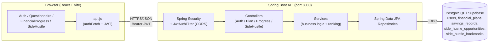
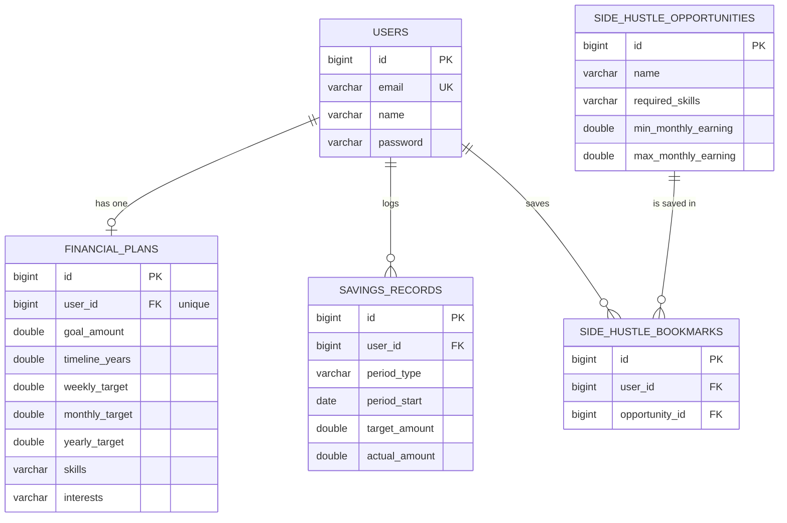

# MilestoneMetrics

**A personalized financial goal-achievement and income-growth platform for teens and young adults.**

MilestoneMetrics helps a young user turn a vague money goal ("I want to save ₹1,00,000 this year") into a concrete, trackable plan. The user completes a short financial questionnaire, the backend generates a personalized savings plan (weekly / monthly / yearly targets), and the user logs their actual savings over time on a dashboard that shows target-vs-actual progress. The platform also recommends side-hustle / income opportunities matched to the user's skills, interests, available time, and income goal.

> **Repository:** `https://github.com/BhoomiMahna/MilestoneMetrics`

---

## Table of Contents

1. [Project Overview](#1-project-overview)
2. [Key Features](#2-key-features)
3. [Complete User Flow](#3-complete-user-flow)
4. [Tech Stack](#4-tech-stack)
5. [Why Each Technology Was Chosen](#5-why-each-technology-was-chosen)
6. [System Architecture](#6-system-architecture)
7. [Frontend Architecture](#7-frontend-architecture)
8. [Backend Architecture](#8-backend-architecture)
9. [Database](#9-database)
10. [API Documentation](#10-api-documentation)
11. [Financial Planning Logic](#11-financial-planning-logic)
12. [Savings Progress Logic](#12-savings-progress-logic)
13. [Side-Hustle Recommendation Logic](#13-side-hustle-recommendation-logic)
14. [External Services / APIs](#14-external-services--apis)
15. [Security](#15-security)
16. [Project Folder Structure](#16-project-folder-structure)
17. [Installation & Setup](#17-installation--setup)
18. [Running the Application](#18-running-the-application)
19. [Testing](#19-testing)
20. [Deployment](#20-deployment)
21. [Future Improvements](#21-future-improvements)
22. [Screenshots / Demo](#22-screenshots--demo)

---

## 1. Project Overview

**What it does.** MilestoneMetrics is a web application where a young user sets a savings goal with a timeline, receives an automatically generated savings plan, tracks real savings against that plan, and discovers side-hustles to help close the gap.

**The problem it solves.** Teens and young adults often *know* they should save but have no concrete plan and no feedback loop. Generic budgeting apps assume steady incomes and existing financial literacy. MilestoneMetrics instead:
- breaks a big goal into small, period-sized targets (per week / month / year),
- gives immediate visual feedback on whether the user is on track, and
- proactively suggests ways to earn more, tied to the user's own goal.

**Who it is for.** Teenagers and young adults who are new to personal finance and want structure and motivation rather than spreadsheets.

**Main objective.** Take a user from *"I have a goal"* to *"I have a plan, I can see my progress, and I know how to earn more"* with as little friction as possible.

### Implementation status (read this first)

This repository is an academic project that was **designed broadly** (see the `.drawio` diagrams at the repo root) but **implemented incrementally**. To keep this README honest, here is exactly what is built in code today versus what exists only in the design diagrams:

| Capability | Status |
|---|---|
| Authentication (signup / login, JWT) | ✅ Implemented |
| Profile & financial questionnaire | ✅ Implemented |
| Financial goal (amount + timeline) | ✅ Implemented |
| Personalized financial plan (weekly/monthly/yearly targets) | ✅ Implemented |
| Savings progress tracking (log actuals, target-vs-actual, %) | ✅ Implemented |
| Dashboard (weekly / monthly / yearly views, chart, history) | ✅ Implemented |
| Side-hustle recommendations (ranked, explainable) + bookmarks | ✅ Implemented |
| Income capture (monthly income / spend / investments) | ✅ Captured as questionnaire inputs that feed the plan |
| Savings streaks & gamification (points, badges, streaks) | ✅ Implemented |
| Rewards / coupons catalog (browse, unlock, redeem, history) | ✅ Implemented (curated **demo** catalog, seeded) |
| In-app notifications & alerts (reminders, badges, coupon unlocks, bill reminders) | ✅ Implemented |
| Investment recommendations (educational, rule-based) | ✅ Implemented |
| Admin panel (role-based: users, coupons, side-hustle catalog, analytics) | ✅ Implemented |
| Income & expense **transaction** management (add/list transactions, bank sync) | 🟠 Not implemented — planned/design-only |
| Reports & financial insights | 🟠 Not implemented — planned/design-only |
| Live external APIs (bank sync, OTP, email/SMS/push, coupon providers, side-hustle scraping, live market/investment data) | 🟠 Not integrated — notifications are **in-app only**; coupons are a seeded **demo** catalog; side-hustle opportunities are served from a seeded database table as a stand-in |

The `.drawio` files (`activity_diagram.drawio`, `dfd_diagrams.drawio`, `system_and_collaboration_diagrams.drawio`) describe the **full intended system**; the sections below describe **what the code actually does**.

> **Verification note.** Everything above marked ✅ **compiles and builds** (backend `mvnw clean test` → `BUILD SUCCESS`, 12 unit tests pass; frontend `npm run build` → success). Full end-to-end runtime verification against the live database **could not be performed** because the configured Supabase host (`db.jvrtxrjccpvajymdruca.supabase.co`) does not currently resolve (the free project is paused/removed). See [Testing](#19-testing) for exactly what is and isn't verified.

---

## 2. Key Features

Each feature is described as **WHAT** it does, **HOW** it works here, and (where relevant) **WHY**.

### 2.1 Authentication
- **What:** Email/password signup and login.
- **How:** `POST /api/auth/signup` stores the user with a BCrypt-hashed password; `POST /api/auth/login` verifies the password and returns a signed JWT plus the user's name/email. The frontend stores the token in `localStorage` and attaches it as `Authorization: Bearer <token>` on every subsequent request.
- **Why:** Stateless JWT auth means the backend keeps no server-side session, which keeps the API simple and horizontally scalable.

### 2.2 Profile & Financial Questionnaire
- **What:** A short form capturing monthly income, monthly spending, current investments, age band, goal amount, and timeline (in years).
- **How:** `Questionnaire.jsx` collects the inputs and `POST /api/plan` persists them onto the user's single `financial_plans` row. This row is the user's combined **profile + goal + plan**.

### 2.3 Financial Goal
- **What:** A target amount and a timeline (e.g. ₹1,04,000 in 1 year).
- **How:** Stored as `goal_amount` and `timeline_years` on `financial_plans`. These drive every downstream calculation.

### 2.4 Personalized Financial Plan
- **What:** Converts the goal into concrete per-period savings targets (weekly / monthly / yearly).
- **How:** On plan save, the backend computes `weeklyTarget`, `monthlyTarget`, `yearlyTarget` from the goal and timeline (see [Financial Planning Logic](#11-financial-planning-logic)) and stores them. Deterministic arithmetic — no black box.

### 2.5 Savings Progress Tracking + Dashboard
- **What:** The user picks a week/month/year and logs how much they actually saved; the dashboard shows target, actual, remaining, and % progress, plus a chart and history.
- **How:** `FinancialProgress.jsx` has Weekly/Monthly/Yearly tabs. Logging calls `POST /api/savings` (upsert per period); the dashboard reads `GET /api/progress?period=...`. See [Savings Progress Logic](#12-savings-progress-logic).

### 2.6 Side-Hustle Recommendations
- **What:** A ranked list of income opportunities personalized to the user, each with an explainable "why this is recommended," plus save/bookmark, filtering and sorting.
- **How:** The user edits skills/interests/available-hours/desired-income; `GET /api/sidehustle/recommendations` scores every opportunity in the catalog against that profile and returns them sorted by match. See [Side-Hustle Recommendation Logic](#13-side-hustle-recommendation-logic).

### 2.7 Savings Streaks & Gamification
- **What:** Points, badges, and savings streaks that reward real saving behaviour (never logins).
- **How:** `GamificationService.evaluate(user)` runs after every savings log. A **qualifying period** is one where `actual ≥ target` and `target > 0`. A **weekly streak** counts consecutive 7-day `WEEK` periods that each qualify; it computes current streak, longest streak, and total qualifying count. Badges (`FIRST_SAVINGS`, `FIRST_TARGET_MET`, `WEEK_STREAK_4`, `WEEK_STREAK_8`, `GOAL_REACHED`) are awarded idempotently — each carries fixed points, stored once via a `unique(user_id, type)` constraint so points/badges can never be duplicated even if savings are re-evaluated. `GET /api/gamification/summary` returns points, earned badges, locked badges, and progress to the next badge. The frontend `Rewards.jsx` shows a one-time celebration when a new badge appears.
- **Why:** Motivation through visible, *earned* progress — awards are tied to savings records, so they recalculate safely and are never fabricated.

### 2.8 Coupons & Offers (demo catalog)
- **What:** A catalog of reward offers the user unlocks with points and redeems once each.
- **How:** `coupons` is a seeded catalog (`CouponDataSeeder`, 6 demo offers); each offer has title/description/reward/category/points-required/expiry/active flag and is explicitly flagged **demo**. `CouponService.listForUser` computes a per-user status (`LOCKED` → not enough points, `AVAILABLE` → unlockable, `REDEEMED` → already claimed, `EXPIRED`/`INACTIVE`). `POST /api/coupons/{id}/redeem` validates eligibility server-side (404 missing, 400 inactive/expired, 403 not enough points, 409 already redeemed), records a `coupon_redemptions` row (`unique(user_id, coupon_id)`), and issues a demo code. Redemption history is available via `GET /api/coupons/redemptions`.
- **Why:** Gives points a purpose while being honest — codes are clearly demo, with no real/external coupon provider.

### 2.9 Notifications & Alerts (in-app)
- **What:** In-app notifications for behind-target savings, new badges/streaks, goal completion, coupon unlocks/redemptions, and user-created bill reminders.
- **How:** `NotificationService.createIfAbsent(...)` writes to the `notifications` table with a per-user `dedupe_key` (`unique(user_id, dedupe_key)`) so the same event is never duplicated. Users can list, see an unread count, mark one/all read, and dismiss; every operation is scoped to the authenticated user (`findByIdAndUser`), so one user can never touch another's notifications. Bill reminders are user-created with an optional due date. **In-app only** — no email/SMS/push is sent or claimed.
- **Why:** Keeps the user informed within the app without over-promising delivery channels that aren't integrated.

### 2.10 Investment Recommendations (educational)
- **What:** Rule-based, educational investment *ideas* derived from the user's questionnaire data — never regulated/personalized financial advice.
- **How:** `InvestmentService` derives a risk profile from `timelineYears` (<2 Conservative, ≤5 Moderate, >5 Growth) and produces horizon-appropriate educational suggestions (emergency fund, short-term vs balanced vs growth instruments like PPF/SIP), each with a plain-English "why relevant." It lists any **missing info** instead of fabricating it, carries a prominent disclaimer, and makes no guaranteed-return or live-market claims. Separate from the side-hustle engine.
- **Why:** Teaches concepts safely; the disclaimer and "educational, not advice" framing keep it clearly distinct from regulated advice.

### 2.11 Admin Panel (role-based)
- **What:** An admin-only area to manage users, coupons, the side-hustle catalog, and view aggregate analytics.
- **How:** A `role` column on `users` (`USER`/`ADMIN`) is embedded in the JWT as a claim; `SecurityConfig` enforces `/api/admin/** → hasRole("ADMIN")` **server-side**, so a normal user cannot reach admin APIs by editing frontend routes or crafting requests. The initial admin is created safely via the `ADMIN_EMAIL` env var (`AdminBootstrap` promotes that already-registered user on startup) — **no hardcoded credentials, no secrets in the frontend**. Admin can list users (sensitive fields restricted), change roles (cannot remove the last admin), create/update/activate/deactivate coupons, manage side-hustle opportunities, and read aggregate counts. The `AdminDashboard.jsx` link only appears for `ADMIN` users, but the real enforcement is on the backend.
- **Why:** Separation of duties with a real authorization boundary, not a cosmetic frontend gate.

### 2.12 Session-expiry handling
- **What:** When a JWT expires, the app returns the user to the login screen with a clear message instead of failing silently.
- **How:** `authFetch` intercepts `401/403`, clears the stored token, and triggers a handler in `App.jsx` that shows *"Your session expired. Please log in again."*

---

## 3. Complete User Flow

The implemented flow is: **Register/Login → Questionnaire → Financial Profile + Goal → Personalized Plan → Dashboard → Savings Tracking → Side-Hustle Recommendations**, with **Rewards, Coupons, Notifications, Investments, and (for admins) an Admin panel** reachable from the in-app navigation bar. Logging savings also drives gamification (points/badges/streaks) and generates relevant notifications.

| Step | Frontend | Backend | Database | External |
|---|---|---|---|---|
| **1. Sign up** | `Auth.jsx` posts name/email/password | `AuthService.signup` hashes password (BCrypt), rejects duplicate emails | Insert into `users` | — |
| **2. Log in** | `Auth.jsx` posts credentials, stores returned JWT + user in `localStorage` | `AuthService.login` verifies BCrypt hash, issues JWT (HS256) | Read `users` | — |
| **3. Route decision** | `App.jsx` calls `GET /api/plan` | Returns the plan or `204` if none | Read `financial_plans` | — |
| **4. Questionnaire** | `Questionnaire.jsx` collects income/spend/investments/age/goal/timeline | `FinancialPlanService.savePlan` computes targets | Upsert `financial_plans` (unique per user) | — |
| **5. Personalized plan** | Preview shown; app navigates to dashboard | Weekly/monthly/yearly targets stored on the plan row | `financial_plans` | — |
| **6. Dashboard** | `FinancialProgress.jsx` loads `GET /api/progress?period=WEEK` | `SavingsService.getProgress` aggregates records + plan target | Read `savings_records`, `financial_plans` | — |
| **7. Log savings** | User selects a period + enters actual; `POST /api/savings` | `SavingsService.saveSavings` upserts, snapshots the period target | Upsert `savings_records` (unique per user+type+start) | — |
| **8. Side-hustle profile** | `SideHustle.jsx` `PUT /api/sidehustle/profile` | `SideHustleService.updateProfile` stores skills/interests/hours/desired income on the plan | Update `financial_plans` | — |
| **9. Recommendations** | `SideHustle.jsx` `GET /api/sidehustle/recommendations` | `SideHustleService.getRecommendations` scores + ranks | Read `side_hustle_opportunities`, `side_hustle_bookmarks` | — (catalog is DB-seeded) |
| **10. Bookmark / apply** | Save toggles bookmark; "View on <platform>" opens the platform URL in a new tab | `add/removeBookmark` | Upsert/delete `side_hustle_bookmarks` | External platform link opened by the user's browser |

---

## 4. Tech Stack

| Technology | Where Used | Why We Chose It |
|---|---|---|
| **Java 17** | Backend language (source/target level) | Long-term-support Java; strong typing catches errors at compile time. Runs on any JDK ≥ 17. |
| **Spring Boot 3.2.5** | Backend framework | Batteries-included web + DI + config; minimal boilerplate for REST APIs. |
| **Spring Web (MVC)** | REST controllers | Clean annotation-based routing (`@RestController`, `@RequestMapping`). |
| **Spring Data JPA / Hibernate** | Persistence layer | Repositories remove hand-written SQL/CRUD; `ddl-auto=update` auto-creates tables from entities. |
| **Spring Security 6** | Auth & authorization | Industry-standard filter chain; integrates JWT and CORS cleanly. |
| **JJWT (io.jsonwebtoken 0.12.5)** | JWT create/verify | Focused, well-maintained JWT library; HS256 signing. |
| **PostgreSQL (hosted on Supabase)** | Database | Relational data with clear foreign keys and uniqueness constraints; Supabase gives a free managed Postgres. |
| **Jakarta Bean Validation** | Request DTO validation | Declarative field constraints (`@NotBlank`, `@Email`, `@Positive`). |
| **Maven (`mvnw` wrapper)** | Build/dependency management | Wrapper means no local Maven install required. |
| **React 19** | Frontend UI | Component model fits a multi-step, state-driven app. |
| **Vite 8** | Frontend build/dev server | Instant dev server + HMR; fast production builds. |
| **Tailwind CSS 4** (`@tailwindcss/vite`) | Styling | Utility-first styling keeps design consistent without separate CSS files. |
| **Oxlint** | Frontend linting | Very fast linter for catching obvious JS/JSX issues. |
| **Fetch API + `localStorage`** | Frontend networking / token storage | No extra HTTP or state library needed for this app's size. |

> There is intentionally **no** external HTTP client (Axios), no Redux/router library, and no ORM beyond JPA — the app is small enough that the platform primitives suffice.

---

## 5. Why Each Technology Was Chosen

**Why Spring Boot (backend framework)?** The app needs authentication, validation, a relational data layer, and REST endpoints. Spring Boot provides all of these as auto-configured starters, so the code we write is almost entirely business logic (services) rather than plumbing. Alternatives like a bare servlet app would require wiring security, JSON, and persistence by hand.

**Why PostgreSQL (relational, not NoSQL)?** The data is highly relational and constraint-driven: a user has exactly one financial plan; a savings record is unique per (user, period type, period start); a bookmark is unique per (user, opportunity). These "one of X per Y" rules are enforced natively with `UNIQUE` constraints and foreign keys. A document store would push that integrity into application code. Supabase was chosen because it offers managed Postgres with SSL at no cost for a student project.

**Why REST (not GraphQL/RPC)?** The client needs a handful of simple, resource-shaped operations (plan, savings, progress, recommendations). REST maps them to obvious HTTP verbs and URLs, is trivial to test with `curl`, and needs no client-side query runtime.

**Why JWT (not server-side sessions)?** JWT keeps the backend stateless — the token itself carries the authenticated identity (the user's email as the `subject`), so no session store is required and the API can scale horizontally. The trade-off (no server-side revocation) is acceptable for this scope; tokens simply expire after 24 hours.

**Why a rules-based recommendation engine (not machine learning)?** With no historical interaction data to train on, an ML model would be guesswork. Instead the engine uses an **explainable weighted-scoring formula** over skills, earning fit, time fit, and interests. This is deterministic, debuggable, and — crucially for a finance product a student must explain in a viva — every score can be justified in plain English on the card itself.

**Why React + Vite + Tailwind?** React's component + state model suits a multi-screen flow (auth → questionnaire → dashboard → side-hustles) driven by a small state machine. Vite gives near-instant reloads during development. Tailwind keeps a single consistent visual language (the warm cream/black/orange theme) without a separate stylesheet per component.

---

## 6. System Architecture

Three layers plus a managed database. The frontend never touches the database directly — all data flows through the REST API, which enforces authentication and per-user isolation.



**Responsibilities**
- **Frontend:** renders screens, collects input, holds the JWT, and calls the API. All routing is client-side state (no server-rendered pages).
- **Security layer:** applies CORS, extracts/validates the JWT on every request, and rejects unauthenticated calls to protected endpoints.
- **Controllers:** map HTTP requests to service calls and translate results to JSON. They read the authenticated user's email from the JWT via `Principal`.
- **Services:** all business logic — password hashing, plan math, progress aggregation, recommendation scoring, per-user data access.
- **Repositories:** Spring Data JPA interfaces; generate SQL from method names.
- **Database:** the single source of truth; integrity enforced by constraints.

**Communication:** JSON over HTTP. The only "external" call the app makes is that the user's browser can open a side-hustle platform's public URL in a new tab — the backend itself makes no outbound API calls.

---

## 7. Frontend Architecture

**Stack:** React 19 + Vite 8 + Tailwind CSS 4, linted with Oxlint. Entry point is `src/main.jsx`, which mounts `App.jsx` in React `StrictMode`.

**Routing / navigation.** There is **no router library**. `App.jsx` is a small state machine with a `view` value: `loading | questionnaire | dashboard | sidehustle | rewards | coupons | notifications | investments | admin`, plus an implicit "not logged in → show `Auth`" branch. The shared `NavBar` switches views by calling an `onNavigate(view)` callback that sets `view`.

**State management.** Local component state via `useState`; cross-session state (the JWT and the user object) lives in `localStorage`. There is no Redux/Context store — the app is small enough that props + local state are clearer.

**Authentication handling.**
- On login, `Auth.jsx` stores `token` and `user` in `localStorage`.
- `api.js` exposes `authFetch`, which attaches `Authorization: Bearer <token>` to every request and parses the JSON response (treating `204` as `null`).
- If any call returns `401/403` (e.g. an expired token), `authFetch` clears the stored session and invokes a registered handler so `App.jsx` returns to the login screen with a notice.

**API communication.** Centralized in `src/api.js`: the base URL (`http://localhost:8080`), `authFetch`, and an `inr()` currency formatter (`₹` + `en-IN` grouping).

**Key files**

| File | Responsibility |
|---|---|
| `src/main.jsx` | React entry; mounts `App`. |
| `src/App.jsx` | Top-level state machine: auth gate, plan check, view switching, session-expiry handler. |
| `src/api.js` | API base URL, `authFetch` (JWT + error handling), `inr` formatter. |
| `src/components/Auth.jsx` | Login/signup tabs; stores token; shows errors and the session-expired notice. |
| `src/components/Questionnaire.jsx` | Profile + goal form; `POST /api/plan`; live monthly-target preview. |
| `src/components/FinancialProgress.jsx` | Dashboard: weekly/monthly/yearly tabs, stat cards, bar chart, history table, "log savings" form. |
| `src/components/SideHustle.jsx` | Side-hustle profile editor, recommendation cards, filters/sorting, bookmarking. |
| `src/components/NavBar.jsx` | Shared top navigation (Dashboard/Rewards/Coupons/Invest/Side-hustles/🔔 with unread count/Admin-if-ADMIN/Logout). |
| `src/components/Rewards.jsx` | Gamification: points, badge grid, progress to next badge, one-time celebration. |
| `src/components/Coupons.jsx` | Points balance + coupon status cards + redeem. |
| `src/components/Notifications.jsx` | List, mark read/all, dismiss, bill-reminder form, unread handling. |
| `src/components/Investments.jsx` | Educational recommendations, risk profile, disclaimer, missing-info notes. |
| `src/components/AdminDashboard.jsx` | Admin tabs: overview/analytics, users, coupons (CRUD), opportunities (CRUD). |
| `src/index.css` | Imports Tailwind. |

**How data is displayed.** Components fetch on mount (and after mutations) via `authFetch`, keep the result in state, and render it. For example, after `POST /api/savings` succeeds, `FinancialProgress` re-fetches `GET /api/progress` so the cards, chart, and history update immediately.

---

## 8. Backend Architecture

**Package:** `com.milestonemetrics.backend`. Classic layered structure: **controller → service → repository → entity**, with security and config packages alongside.

**How a request travels through the backend** (example: `GET /api/progress?period=WEEK`):
1. **CORS filter** allows the `http://localhost:5173` origin.
2. **`JwtAuthFilter`** (a `OncePerRequestFilter`) reads the `Authorization: Bearer` header, validates the token with `JwtUtil`, and — if valid — sets a `UsernamePasswordAuthenticationToken` whose principal is the user's **email** into the `SecurityContext`.
3. **Spring Security** checks the rule set in `SecurityConfig`: `/api/auth/**` and `/error` are public; **every other endpoint requires authentication**. Unauthenticated requests get `403`.
4. **`ProgressController`** receives the request, reads `principal.getName()` (the email), and calls the service.
5. **`SavingsService`** resolves the `User` by email, loads the plan + savings records, computes the aggregates, and returns a `ProgressResponse` DTO.
6. **Spring** serializes the DTO to JSON.

**Components**

| Layer | Classes |
|---|---|
| Controllers | `AuthController`, `FinancialPlanController`, `ProgressController`, `SideHustleController`, `GamificationController`, `CouponController`, `NotificationController`, `InvestmentController`, `AdminController`, `GlobalExceptionHandler` |
| Services | `AuthService`, `FinancialPlanService`, `SavingsService`, `SideHustleService`, `GamificationService`, `CouponService`, `NotificationService`, `InvestmentService`, `AdminService` |
| Repositories | `UserRepository`, `FinancialPlanRepository`, `SavingsRecordRepository`, `SideHustleOpportunityRepository`, `SideHustleBookmarkRepository`, `UserAchievementRepository`, `CouponRepository`, `CouponRedemptionRepository`, `NotificationRepository` |
| Entities | `User`, `FinancialPlan`, `SavingsRecord`, `PeriodType` (enum), `SideHustleOpportunity`, `SideHustleBookmark`, `Difficulty` (enum), `Role` (enum), `UserAchievement`, `AchievementType` (enum), `Coupon`, `CouponRedemption`, `Notification`, `NotificationType` (enum) |
| Security | `SecurityConfig`, `JwtAuthFilter`, `JwtUtil` |
| Config | `SideHustleDataSeeder`, `CouponDataSeeder` (seed catalogs on first run), `AdminBootstrap` (promotes `ADMIN_EMAIL` on startup) |
| DTOs | `SignupRequest`, `LoginRequest`, `AuthResponse`, `MessageResponse`, `PlanRequest`, `PlanResponse`, `SavingsRequest`, `SavingsRecordResponse`, `ProgressResponse`, `SideHustleProfileRequest`, `SideHustleProfileResponse`, `RecommendationResponse`, `GamificationSummaryResponse`, `CouponResponse`, `CouponListResponse`, `RedeemResponse`, `NotificationResponse`, `BillReminderRequest`, `InvestmentRecommendationResponse`, `AdminUserResponse`, `AdminAnalyticsResponse`, `CouponAdminRequest`, `OpportunityAdminRequest`, `RoleUpdateRequest` |

**Middleware / cross-cutting**
- **`JwtAuthFilter`** — authentication on every request.
- **`GlobalExceptionHandler`** (`@RestControllerAdvice`) — turns `ResponseStatusException` into `{status, message}` JSON and bean-validation failures into `{status:400, errors:{field:message}}`.

**Error handling.** Services throw `ResponseStatusException` with an HTTP status and human-readable reason (e.g. `404 "Complete the questionnaire first"`, `409 "An account with this email already exists"`). `server.error.include-message=always` ensures messages reach the client.

---

## 9. Database

**Engine:** PostgreSQL (hosted on Supabase). **Schema management:** Hibernate `ddl-auto=update` creates/updates tables from the JPA entities on startup — there are no hand-written migrations.

### Tables

**`users`**
| Column | Type | Notes |
|---|---|---|
| `id` | bigint (PK, identity) | |
| `name` | varchar(100) | not null |
| `email` | varchar(255) | not null, **unique** |
| `password` | varchar(255) | BCrypt hash |
| `role` | varchar(20) | `USER` / `ADMIN`, not null, default `USER` |
| `created_at` | timestamp | |

**`financial_plans`** — one row per user (profile + goal + computed plan + side-hustle inputs)
| Column | Type | Notes |
|---|---|---|
| `id` | bigint (PK) | |
| `user_id` | bigint (FK → users) | **unique** (one plan per user) |
| `monthly_income`, `monthly_spend`, `current_investments` | double | questionnaire inputs |
| `age_band` | varchar(20) | e.g. "18–25" |
| `goal_amount` | double | not null |
| `timeline_years` | double | not null |
| `weekly_target`, `monthly_target`, `yearly_target` | double | computed plan |
| `skills`, `interests` | varchar(500) | comma-separated (side-hustle inputs) |
| `available_hours_per_week` | integer | side-hustle input |
| `desired_monthly_income` | double | side-hustle input |
| `created_at`, `updated_at` | timestamp | |

**`savings_records`** — one actual-savings entry per period
| Column | Type | Notes |
|---|---|---|
| `id` | bigint (PK) | |
| `user_id` | bigint (FK → users) | |
| `period_type` | varchar(10) | `WEEK` / `MONTH` / `YEAR` |
| `period_start`, `period_end` | date | |
| `period_label` | varchar(60) | e.g. "7 Sep – 13 Sep" |
| `target_amount` | double | snapshot of the plan target at log time |
| `actual_amount` | double | not null |
| `created_at`, `updated_at` | timestamp | |
| | | **unique (`user_id`, `period_type`, `period_start`)** |

**`side_hustle_opportunities`** — the opportunity catalog (seeded)
| Column | Type | Notes |
|---|---|---|
| `id` | bigint (PK) | |
| `name`, `description` | varchar | |
| `required_skills`, `interest_tags` | varchar(400) | comma-separated |
| `min_monthly_earning`, `max_monthly_earning` | double | |
| `min_hours_per_week`, `max_hours_per_week` | integer | |
| `difficulty` | varchar(20) | `BEGINNER` / `INTERMEDIATE` / `ADVANCED` |
| `is_online` | boolean | |
| `platform_name`, `platform_url` | varchar | |

**`side_hustle_bookmarks`** — saved opportunities
| Column | Type | Notes |
|---|---|---|
| `id` | bigint (PK) | |
| `user_id` | bigint (FK → users) | |
| `opportunity_id` | bigint (FK → side_hustle_opportunities) | |
| `created_at` | timestamp | |
| | | **unique (`user_id`, `opportunity_id`)** |

**`user_achievements`** — badges/points earned (gamification)
| Column | Type | Notes |
|---|---|---|
| `id` | bigint (PK) | |
| `user_id` | bigint (FK → users) | |
| `type` | varchar(40) | achievement enum (`FIRST_SAVINGS`, `FIRST_TARGET_MET`, `WEEK_STREAK_4`, `WEEK_STREAK_8`, `GOAL_REACHED`) |
| `points_awarded` | integer | fixed per type |
| `created_at` | timestamp | |
| | | **unique (`user_id`, `type`)** — prevents duplicate points/badges |

**`coupons`** — seeded demo reward catalog
| Column | Type | Notes |
|---|---|---|
| `id` | bigint (PK) | |
| `title`, `description` | varchar | |
| `reward_label` | varchar | e.g. "₹100 off" |
| `category` | varchar | |
| `points_required` | integer | unlock threshold |
| `expiry_date` | date | nullable |
| `active` | boolean | admin can toggle |
| `demo` | boolean | always true (honest: not a real coupon) |
| `demo_code` | varchar | code issued on redemption |
| `created_at` | timestamp | |

**`coupon_redemptions`** — redemption history
| Column | Type | Notes |
|---|---|---|
| `id` | bigint (PK) | |
| `user_id` | bigint (FK → users) | |
| `coupon_id` | bigint (FK → coupons) | |
| `code_issued` | varchar | |
| `redeemed_at` | timestamp | |
| | | **unique (`user_id`, `coupon_id`)** — prevents repeated redemption |

**`notifications`** — in-app notifications
| Column | Type | Notes |
|---|---|---|
| `id` | bigint (PK) | |
| `user_id` | bigint (FK → users) | |
| `type` | varchar(40) | enum (savings reminder, behind-target, achievement, streak, goal, coupon unlock/redeem, bill reminder) |
| `title`, `message` | varchar | |
| `is_read` | boolean | read/unread state |
| `dedupe_key` | varchar | per-event key |
| `due_date` | date | nullable (bill reminders) |
| `created_at` | timestamp | |
| | | **unique (`user_id`, `dedupe_key`)** — prevents duplicate notifications |

### Relationships / ER diagram



**Why this design.** The user's profile, goal, and computed plan are naturally 1:1, so they live on a single `financial_plans` row (simpler than splitting across tables and joining constantly). Time-series savings and bookmarks are 1:many, so they are separate tables. The unique constraints encode the business rules directly in the schema, so "log the same week twice" becomes an update, not a duplicate.

---

## 10. API Documentation

Base URL: `http://localhost:8080`. All responses are JSON. Authenticated endpoints require `Authorization: Bearer <token>`; the user is resolved from the token, so no user id is ever passed in the URL or body.

### Auth (public)

| Method | Endpoint | Purpose | Auth | Request body | Success response |
|---|---|---|---|---|---|
| POST | `/api/auth/signup` | Register | none | `{name, email, password}` | `201 {"message":"User registered successfully"}` |
| POST | `/api/auth/login` | Log in | none | `{email, password}` | `200 {"token","email","name"}` |

```bash
curl -X POST http://localhost:8080/api/auth/signup \
  -H "Content-Type: application/json" \
  -d '{"name":"Jane","email":"jane@example.com","password":"secret123"}'
```

### Financial plan (authenticated)

| Method | Endpoint | Purpose | Request | Response |
|---|---|---|---|---|
| POST | `/api/plan` | Create/update plan from questionnaire | `{monthlyIncome, monthlySpend, currentInvestments, ageBand, goalAmount, timelineYears}` | `200` plan with computed `weeklyTarget`, `monthlyTarget`, `yearlyTarget` |
| GET | `/api/plan` | Get current plan | — | `200` plan, or `204` if none |

```json
// POST /api/plan  ->  200
{
  "id": 1, "monthlyIncome": 40000, "monthlySpend": 25000, "currentInvestments": 10000,
  "ageBand": "18-25", "goalAmount": 104000, "timelineYears": 1,
  "weeklyTarget": 2000, "monthlyTarget": 8667, "yearlyTarget": 104000
}
```

### Savings & progress (authenticated)

| Method | Endpoint | Purpose | Request | Response |
|---|---|---|---|---|
| GET | `/api/progress?period=WEEK\|MONTH\|YEAR` | Dashboard data for a view | query `period` (default `WEEK`) | `ProgressResponse` (below) |
| POST | `/api/savings` | Log/update actual savings for a period | `{periodType, periodStart, periodEnd, periodLabel, actualAmount}` | the saved record with `percent`, `remaining` |

```json
// GET /api/progress?period=WEEK  ->  200
{
  "periodType": "WEEK", "goalAmount": 104000, "targetPerPeriod": 2000,
  "totalTarget": 2000, "totalActual": 1700, "remainingToGoal": 102300, "goalPercent": 1.6,
  "records": [
    { "id": 1, "periodLabel": "7 Sep – 13 Sep", "targetAmount": 2000,
      "actualAmount": 1700, "remaining": 300, "percent": 85.0 }
  ]
}
```

### Side-hustle (authenticated)

| Method | Endpoint | Purpose | Request | Response |
|---|---|---|---|---|
| GET | `/api/sidehustle/profile` | Get skills/interests/hours/desired income | — | `{skills[], interests[], availableHoursPerWeek, desiredMonthlyIncome}` |
| PUT | `/api/sidehustle/profile` | Update those inputs | `{skills[], interests[], availableHoursPerWeek, desiredMonthlyIncome}` | updated profile |
| GET | `/api/sidehustle/recommendations` | Ranked recommendations | — | array of `RecommendationResponse` (sorted by `matchScore` desc); `404` if no plan yet |
| POST | `/api/sidehustle/bookmarks/{opportunityId}` | Save an opportunity | — | `200` |
| DELETE | `/api/sidehustle/bookmarks/{opportunityId}` | Remove a bookmark | — | `204` |

```json
// One element of GET /api/sidehustle/recommendations
{
  "id": 3, "name": "Coding Tutor", "description": "...",
  "requiredSkills": ["Python","Web Development","Teaching","Communication"],
  "interestTags": ["Teaching","Coding"],
  "minMonthlyEarning": 8000, "maxMonthlyEarning": 30000,
  "minHoursPerWeek": 4, "maxHoursPerWeek": 12,
  "difficulty": "BEGINNER", "online": true,
  "platformName": "Preply", "platformUrl": "https://preply.com",
  "matchScore": 78, "matchedSkills": ["Python","Web Development"],
  "whyRecommended": "Matches your skills: Python, Web Development · fits your ~10 hrs/week · can earn ₹8,000–₹30,000/month toward your ₹10,000/month goal · aligned with your interest in Teaching, Coding",
  "bookmarked": false
}
```

### Gamification (authenticated)

| Method | Endpoint | Purpose | Response |
|---|---|---|---|
| GET | `/api/gamification/summary` | Points, earned/locked badges, streaks, progress to next badge | `GamificationSummaryResponse` |

### Coupons (authenticated)

| Method | Endpoint | Purpose | Response |
|---|---|---|---|
| GET | `/api/coupons` | Current points + all coupons with per-user status (`LOCKED`/`AVAILABLE`/`REDEEMED`/`EXPIRED`/`INACTIVE`) | `CouponListResponse` |
| POST | `/api/coupons/{id}/redeem` | Redeem a coupon | `200` + issued demo code; `404`/`400`/`403`/`409` on invalid/ineligible/duplicate |
| GET | `/api/coupons/redemptions` | Redemption history (newest first) | array of redemptions |

### Notifications (authenticated)

| Method | Endpoint | Purpose | Response |
|---|---|---|---|
| GET | `/api/notifications` | List this user's notifications | array |
| GET | `/api/notifications/unread-count` | Unread badge count | `{count}` |
| POST | `/api/notifications/{id}/read` | Mark one read (own only; `404` otherwise) | `200` |
| POST | `/api/notifications/read-all` | Mark all read | `200` |
| DELETE | `/api/notifications/{id}` | Dismiss one (own only) | `204` |
| POST | `/api/notifications/bill-reminder` | Create a bill reminder | `{title, message, dueDate}` → `200` |

### Investments (authenticated)

| Method | Endpoint | Purpose | Response |
|---|---|---|---|
| GET | `/api/investments/recommendations` | Educational, rule-based ideas from the plan + risk profile + disclaimer + any missing info | `InvestmentRecommendationResponse` |

### Admin (authenticated **+ `ROLE_ADMIN`**, enforced in `SecurityConfig`)

| Method | Endpoint | Purpose |
|---|---|---|
| GET | `/api/admin/users` | List users (sensitive fields restricted) |
| PUT | `/api/admin/users/{id}/role` | Change a user's role (cannot remove the last admin) |
| GET | `/api/admin/analytics` | Aggregate counts (users, admins, plans, redemptions, …) |
| GET/POST/PUT | `/api/admin/coupons` · `/api/admin/coupons/{id}` | List / create / update coupons |
| PUT | `/api/admin/coupons/{id}/active` | Activate / deactivate a coupon |
| GET/POST/PUT/DELETE | `/api/admin/opportunities` · `/api/admin/opportunities/{id}` | Manage the side-hustle catalog |

> A non-admin JWT calling any `/api/admin/**` endpoint receives `403` — the check is server-side, independent of the frontend.

**Error shape** (from `GlobalExceptionHandler`): `{"status": 4xx, "message": "..."}`, or for validation `{"status":400,"errors":{"field":"message"}}`.

---

## 11. Financial Planning Logic

Implemented in `FinancialPlanService.savePlan`. It is deterministic arithmetic — the goal divided across the number of periods in the timeline, rounded **up** so the targets never under-shoot the goal.

Given `goal = goalAmount` and `years = timelineYears`:

```
weeks       = max(round(years × 52), 1)
months      = max(round(years × 12), 1)
wholeYears  = max(round(years), 1)

weeklyTarget  = ceil(goal / weeks)
monthlyTarget = ceil(goal / months)
yearlyTarget  = ceil(goal / wholeYears)
```

**Worked example** (goal ₹1,04,000 over 1 year): `weeks = 52 → weeklyTarget = ⌈104000/52⌉ = 2000`; `months = 12 → monthlyTarget = ⌈104000/12⌉ = 8667`; `wholeYears = 1 → yearlyTarget = 104000`. These three values are stored on the plan and become the per-period targets the dashboard compares against.

The `monthlyIncome`, `monthlySpend`, and `currentInvestments` fields are captured as the user's financial profile; they are stored on the plan and also used as a fallback for the side-hustle "desired income" when the user hasn't set one explicitly.

---

## 12. Savings Progress Logic

Implemented in `SavingsService` + `SavingsRecordResponse`.

**Recording (upsert).** `saveSavings` looks up an existing record by `(user, periodType, periodStart)`. If found it updates it; otherwise it creates one. At save time it **snapshots** the relevant plan target (`weeklyTarget`/`monthlyTarget`/`yearlyTarget`) into `target_amount`, so historical rows stay stable even if the plan later changes. Logging the same week again therefore updates the amount rather than duplicating it.

**Per-record figures** (`SavingsRecordResponse`):
```
remaining = max(targetAmount − actualAmount, 0)
percent   = targetAmount > 0 ? round(actualAmount / targetAmount × 1000) / 10 : 0   // 1-decimal %
```
Example: target ₹2,000, actual ₹1,700 → remaining ₹300, percent **85.0%**.

**Aggregated view** (`getProgress(period)`):
```
targetPerPeriod = plan target for the selected period type
totalActual     = Σ actualAmount over that type's records
totalTarget     = Σ targetAmount over those records
remainingToGoal = max(goalAmount − totalActual, 0)
goalPercent     = goalAmount > 0 ? min(round(totalActual / goalAmount × 1000)/10, 100) : 0
```
Weekly, monthly, and yearly are **independent views** — each aggregates only the records of its own `period_type`, which avoids double-counting the same rupees across views. Records are returned newest-first for the history table and chart.

---

## 13. Side-Hustle Recommendation Logic

Implemented in `SideHustleService`. It is a transparent **weighted-scoring** engine — not machine learning — so every number is explainable.

**Inputs used** (all from the user's `financial_plans` row): `skills`, `interests` (comma-separated), `availableHoursPerWeek`, and `desiredMonthlyIncome` (falling back to the plan's `monthlyTarget` when unset).

**Where opportunities come from.** A catalog table `side_hustle_opportunities`, seeded on first startup by `SideHustleDataSeeder` (12 realistic opportunities). This is the database-backed stand-in for the "Side-Hustle Platforms" integration in the design diagrams — the app makes **no live external calls**.

**Scoring.** For each opportunity, four sub-scores in `[0,1]` are combined with fixed weights summing to 100:

| Factor | Weight | How it's computed |
|---|---|---|
| Skill match | 45 | `matchedSkills / requiredSkills` (case-insensitive); `0.5` neutral if the opportunity lists no skills |
| Earning fit | 25 | `min(1, avgEarning / desiredIncome)` where `avgEarning = (min+max)/2`; `1.0` if no desired income |
| Time fit | 20 | `1.0` if `availableHours ≥ minHours`; else `availableHours / minHours`; `0.5` if availability unknown |
| Interest match | 10 | `matchedInterestTags / interestTags` |

```
matchScore = round(45·skillFit + 25·earningFit + 20·timeFit + 10·interestFit)   // clamped 0..100
```

**Explanation.** For each opportunity the service builds a human-readable `whyRecommended` string from the matched skills, the time fit, the earning range "toward your ₹X/month goal", and matched interests — the exact text shown on the card.

**Return + display.** `getRecommendations` returns **all** opportunities sorted by `matchScore` descending (and `404`s if the user has no plan yet, enforcing the flow). Each item includes a `bookmarked` flag. The frontend (`SideHustle.jsx`) renders them as cards and provides **client-side** filtering (skill, max time, min earning, difficulty, online/offline, saved-only) and sorting (best match / earning / least time) over that list. Editing the profile and saving re-fetches recommendations so the ranking updates live.

**Worked example.** For *Python + Web Development, 10 hrs/week, wants ₹10,000/month*, the top matches are **Coding Tutor (78%)**, **Technical Content Creator**, **Freelance Python Developer**, and **Web Development Freelancer** — because they match multiple skills, fit the available time, and their earning ranges cover the ₹10,000 goal.

---

## 14. External Services / APIs

**Honest status:** the running application currently makes **no outbound calls to third-party APIs.** The design diagrams envisage bank/payment sync, an authentication/OTP provider, notification services, coupon providers, and side-hustle platform scraping, but none of these are integrated in code.

What exists instead:
- **Database (PostgreSQL on Supabase).** This is the one external dependency the backend connects to (over JDBC/SSL). It stores all application data. Connection details come from environment variables; if the database is unreachable the app fails fast on startup (Hikari connection error) rather than serving broken requests.
- **Side-hustle "platforms".** Represented by the seeded `side_hustle_opportunities` catalog. Each row carries a public `platform_url` (e.g. Upwork, Fiverr, Preply). The **user's browser** opens that URL when they click "View on <platform>"; the backend never calls it.

Because there are no live integrations, there is no external-API failure handling to document beyond the database connection.

---

## 15. Security

Implemented mechanisms (all present in code):

- **Password hashing.** Passwords are hashed with **BCrypt** (`BCryptPasswordEncoder`) before storage; the plaintext is never persisted. Login compares via `passwordEncoder.matches`.
- **JWT authentication.** `JwtUtil` issues **HS256** tokens with the user's email as the subject and a 24-hour expiry (`jwt.expiration=86400000`). The signing secret comes from the `JWT_SECRET` environment variable. `JwtAuthFilter` validates the token on every request; invalid/expired tokens simply result in no authentication being set.
- **Stateless sessions.** Spring Security is configured with `SessionCreationPolicy.STATELESS` — no server-side session is created.
- **Authorization rules.** `SecurityConfig` permits only `/api/auth/**` and `/error`; **`/api/admin/**` requires `hasRole("ADMIN")`**; every other endpoint requires a valid JWT. Unauthenticated requests receive `403`.
- **Role-based admin access.** Each user has a `role` (`USER`/`ADMIN`). `JwtUtil` embeds the role as a token claim; `JwtAuthFilter` grants `ROLE_<role>` authority. Admin enforcement is entirely server-side, so hiding the admin link in the UI is cosmetic only — a forged request from a normal user still gets `403`. The first admin is created via the `ADMIN_EMAIL` environment variable (`AdminBootstrap` promotes that registered user on startup); there are **no hardcoded admin credentials and no admin secrets in the frontend**.
- **Per-user data isolation.** Controllers never accept a user id from the client. They read the authenticated email from the JWT (`Principal`), resolve the `User`, and every query is scoped to that user (`findByUser`, `findByUserAndPeriodType...`, `findByUserAndOpportunityId`). One user therefore cannot read or modify another user's plan, savings, or bookmarks.
- **Input validation.** Request DTOs use Jakarta Bean Validation (`@NotBlank`, `@Email`, `@Size(min=6)` on passwords, `@NotNull`, `@Positive`, `@PositiveOrZero`). Violations are turned into a structured `400` by `GlobalExceptionHandler`.
- **CORS.** Restricted to the frontend origin `http://localhost:5173` with an explicit method allow-list.
- **CSRF.** Disabled deliberately — safe here because the API is stateless and token-based (no cookie-based auth to forge).
- **Secrets management.** DB credentials and the JWT secret are read from `code/backend/.env`, which is git-ignored; a non-secret `code/backend/.env.example` documents the required keys.
- **Frontend session handling.** `authFetch` clears the stored token on `401/403` and routes the user back to login.

**Known trade-offs (not vulnerabilities to hide):** the JWT is stored in `localStorage` (simple, but readable by JS — a hardened version would use an httpOnly cookie); tokens cannot be revoked before expiry (no refresh/blacklist); and the dev JWT secret must be a strong random value in any real deployment.

---

## 16. Project Folder Structure

```
MilestoneMetrics/
├─ README.md                     ← this file
├─ .gitignore
├─ start-backend.bat             ← convenience script (loads .env, runs the backend)
├─ activity_diagram.drawio       ← design: UML activity diagram
├─ dfd_diagrams.drawio           ← design: DFD levels 0/1/2
├─ system_and_collaboration_diagrams.drawio  ← design: system/collaboration diagrams
├─ docs/ journals/ project-* /   ← academic docs (proposal, reports, journals)
└─ code/
   ├─ backend/                   ← Spring Boot API
   │  ├─ pom.xml
   │  ├─ mvnw / mvnw.cmd         ← Maven wrapper
   │  ├─ .env.example            ← required env keys (no secrets)
   │  └─ src/main/java/com/milestonemetrics/backend/
   │     ├─ BackendApplication.java
   │     ├─ config/              ← SecurityConfig, SideHustleDataSeeder, CouponDataSeeder, AdminBootstrap, DevDataSeeder (@Profile("dev"))
   │     ├─ controller/          ← Auth, FinancialPlan, Progress, SideHustle, Gamification, Coupon, Notification, Investment, Admin, GlobalExceptionHandler
   │     ├─ service/             ← Auth, FinancialPlan, Savings, SideHustle, Gamification, Coupon, Notification, Investment, Admin
   │     ├─ repository/          ← Spring Data JPA interfaces
   │     ├─ entity/              ← User, FinancialPlan, SavingsRecord, SideHustle*, UserAchievement, Coupon, CouponRedemption, Notification, enums (Role, AchievementType, NotificationType, …)
   │     ├─ dto/                 ← request/response objects
   │     └─ security/            ← JwtUtil, JwtAuthFilter
   │  ├─ src/main/resources/application.properties          ← production (Supabase) config
   │  ├─ src/main/resources/application-dev.properties      ← dev profile (in-memory H2)
   │  └─ src/test/java/…/service/ ← StreakLogicTest, CouponServiceTest, NotificationServiceTest (DB-free unit tests)
   └─ frontend/                  ← React + Vite app
      ├─ package.json
      ├─ vite.config.js
      ├─ index.html
      └─ src/
         ├─ main.jsx             ← entry
         ├─ App.jsx              ← view state machine / auth gate
         ├─ api.js               ← authFetch + JWT + formatting
         ├─ index.css            ← Tailwind import
         └─ components/          ← Auth, Questionnaire, FinancialProgress, SideHustle, NavBar, Rewards, Coupons, Notifications, Investments, AdminDashboard
```

---

## 17. Installation & Setup

### Prerequisites
- **JDK 17 or newer** (`java -version` should print ≥ 17)
- **Node.js 18+** and npm
- A **PostgreSQL** database **only for production** (the project targets a Supabase Postgres instance). **Not required** for local preview — see the H2 dev profile below.

### 1. Clone
```bash
git clone https://github.com/BhoomiMahna/MilestoneMetrics.git
cd MilestoneMetrics
```

### Quick local preview — H2 dev profile (no database or `.env` needed)

For demonstrating the app locally without any external database, run the backend under the **`dev`** Spring profile. It uses an in-memory **H2** database and a dev-only seeder (`DevDataSeeder`) that loads clearly-labelled demo data. **No `.env`, no Supabase, and no `JWT_SECRET` are required** — the dev profile supplies its own. Real BCrypt + JWT auth are still used; authentication is not weakened.

```bash
# Terminal 1 — backend on H2 (Windows PowerShell)
cd code/backend
$env:JAVA_HOME="D:\java"            # or any JDK 17+ home
.\mvnw.cmd spring-boot:run "-Dspring-boot.run.profiles=dev"

# macOS / Linux
cd code/backend
./mvnw spring-boot:run -Dspring-boot.run.profiles=dev
```
```bash
# Terminal 2 — frontend
cd code/frontend
npm install
npm run dev
```
Open **http://localhost:5173**. The dev seeder creates two demo accounts (printed to the backend console on startup):

| Account | Email | Password |
|---|---|---|
| Normal user (rich demo history) | `demo@milestonemetrics.local` | `Demo@12345` |
| Admin (lands on dashboard, has the **Admin** nav link) | `admin@milestonemetrics.local` | `Admin@12345` |

> The H2 database is in-memory: every backend restart re-seeds a fresh, predictable dataset. The `dev` profile never reads or writes the production/Supabase database. The demo data is clearly labelled (`Demo …`, `@milestonemetrics.local`, `[DEMO]`) and is never presented as real user data. To see empty states, click **sign up** and register a brand-new account.

### 2. Configure backend environment (production / Supabase)
Create `code/backend/.env` from the example and fill in your own values:
```bash
cp code/backend/.env.example code/backend/.env
```
```
DB_URL=jdbc:postgresql://<your-supabase-host>:5432/<your-database>?sslmode=require
DB_USERNAME=postgres
DB_PASSWORD=<your-supabase-db-password>
JWT_SECRET=<a-strong-random-string-of-at-least-32-chars>
# Optional: promote an already-registered account to ADMIN on startup
ADMIN_EMAIL=
```
> `.env` is git-ignored — never commit real secrets. Tables are created automatically by Hibernate on first run; no manual SQL is needed.

#### Creating the initial administrator (safe method)
There are **no hardcoded admin accounts**. To create the first admin:
1. Sign up normally through the app with the email you want to be admin.
2. Set `ADMIN_EMAIL=<that-email>` in `code/backend/.env`.
3. Restart the backend. `AdminBootstrap` promotes that user to `ADMIN` once (idempotent — safe to leave set or clear afterwards).

That admin can then promote others via `PUT /api/admin/users/{id}/role` (the service refuses to remove the last remaining admin).

### 3. Install frontend dependencies
```bash
cd code/frontend
npm install
```

---

## 18. Running the Application

Run the two services in **separate terminals**. For a zero-setup local preview use the **H2 dev profile** (see [Quick local preview](#quick-local-preview--h2-dev-profile-no-database-or-env-needed) above); the steps below run the **production** profile against a real PostgreSQL/Supabase database.

### Backend (port 8080)
The backend needs the `.env` values as environment variables.

**Windows (from the repo root)** — a helper script is provided:
```bat
start-backend.bat
```
**macOS / Linux:**
```bash
cd code/backend
set -a && . ./.env && set +a
./mvnw spring-boot:run
```
Wait for `Started BackendApplication`. The API is now at `http://localhost:8080`.

### Frontend (port 5173)
```bash
cd code/frontend
npm run dev
```
Open **http://localhost:5173**, sign up, complete the questionnaire, and you'll land on the dashboard.

Available frontend scripts: `npm run dev` (dev server), `npm run build` (production build), `npm run preview` (serve the build), `npm run lint` (Oxlint).

---

## 19. Testing

**What is verified (actually run):**

- **Backend build + unit tests:** `./mvnw clean test` → **`BUILD SUCCESS`, 12 tests, 0 failures, 0 errors.** These are database-free unit tests covering the core business rules:
  - `StreakLogicTest` (5 tests) — the streak math (current/longest/qualifying counts) across gaps, single periods, and unbroken runs.
  - `CouponServiceTest` (3 tests) — redemption is refused with `403` when points are insufficient, `409` when already redeemed, and succeeds (issuing a code, saving exactly one redemption) when eligible.
  - `NotificationServiceTest` (3 tests) — duplicate events are skipped by `dedupe_key`, a fresh event is saved, and acting on another user's notification returns `404` (ownership isolation).
  - `BackendApplicationTests.contextLoads()` (1 test) — a no-op placeholder (not a Spring context boot, so it needs no DB).
  ```bash
  cd code/backend
  ./mvnw clean test
  ```
  > Business logic (`GamificationService`, `NotificationService`, `CouponService`) is mocked with Mockito, so no database is required. The POM sets `-Dnet.bytebuddy.experimental=true` for Surefire so Mockito can create mocks on newer JDKs (the test JVM here is JDK 26, newer than the bundled Byte Buddy officially supports).
- **Frontend build + lint:** `npm run build` → **success** (27 modules transformed, production bundle emitted); `npm run lint` (Oxlint) → **0 errors** (2 benign pre-existing unused-variable warnings).

- **Live end-to-end runtime verification (against the H2 `dev` profile):** the full application was started (backend on H2 + frontend) and all primary journeys were exercised with **real API calls and persisted data** — **25/25 scripted checks passed**, covering:
  1. Register → login → questionnaire (`POST /api/plan`, weekly target computed correctly) → dashboard.
  2. Record weekly savings → correct weekly progress aggregation; re-logging a period **upserts** (no duplicate record).
  3. Savings drives streaks/points/badges; **repeated summary calls do not duplicate points** (idempotent).
  4. Coupons list with correct per-user status; redeem succeeds, **duplicate redeem → `409`**, redeeming a **locked** coupon → `403`.
  5. Notifications list + unread count; mark-read decrements unread; **repeated page loads do not create duplicate notifications** (deduped by `dedupe_key`).
  6. Side-hustle recommendations returned and ranked.
  7. Investment recommendations derived from the saved plan (risk profile + disclaimer).
  8. Admin CRUD: create/deactivate coupon, create/delete opportunity, change a user's role — all succeed.
  9. Authorization: a normal user calling `/api/admin/**` → `403`; a user acting on **another user's** notification → `404` (ownership isolation); no-token request → `403`.
  10. Existing and newly-registered accounts both work after a backend restart (fresh re-seed).
- **UI verification (browser):** logged in through the real UI and visually confirmed the Dashboard, Rewards, Coupons (all five states: available/locked/redeemed/expired + "earn X more"), Notifications, Investments, and the Admin dashboard (overview analytics + users table) all render correctly with **no browser-console errors**.

**What could NOT be verified (external environment, not code):**

- **The production Supabase database remains unreachable.** The configured host `db.jvrtxrjccpvajymdruca.supabase.co` **does not resolve** (`nslookup` → "Non-existent domain") — the free Supabase project is paused or removed. The runtime verification above was therefore performed against the **H2 dev profile**, not Supabase. To run in production, point `DB_URL`/`DB_USERNAME`/`DB_PASSWORD` at a reachable PostgreSQL instance (restore/unpause Supabase or use a local Postgres) and set `ADMIN_EMAIL`. Hibernate `ddl-auto=update` creates the new tables (`user_achievements`, `coupons`, `coupon_redemptions`, `notifications`, plus the `role` column) non-destructively on first run.

**Frontend:** no component/unit test suite yet (a valuable next step).

---

## 20. Deployment

There is **no deployment pipeline configured** in this repository — no Dockerfile, no CI/CD workflow, no hosting config. The application is currently run locally as described above. The only hosted component is the **PostgreSQL database on Supabase**.

A realistic path to deployment (not yet implemented) is noted under Future Improvements.

---

## 21. Future Improvements

Clearly labelled as **not yet implemented**:

- **Income & expense transactions:** a real ledger (add/list/categorize transactions) and optional bank-sync, rather than only the summary figures captured in the questionnaire.
- **Reports & financial insights:** trends, breakdowns, and downloadable summaries.
- **Live external integrations:** real side-hustle platform APIs, payment/bank sync, **real** coupon providers, email/SMS/push notification delivery (current notifications are in-app only), OTP-based auth, and live market data for investments (current investment suggestions are static educational rules).
- **Scheduled reminders:** the notification model stores a `due_date`, but there is no background scheduler that fires reminders at a time — they are created on demand. A scheduler (e.g. Spring `@Scheduled`) would make date-based reminders proactive.
- **Auth hardening:** move the JWT to an httpOnly cookie, add refresh tokens and token revocation, and configurable expiry.
- **Testing:** expand to more service-layer unit tests (plan math, progress aggregation, recommendation scoring) and add API integration tests (e.g. `@SpringBootTest` with Testcontainers Postgres) and frontend component tests.
- **Deployment:** containerize the backend, build and host the frontend as static assets, and add a CI workflow.
- **Recommendation upgrades:** learn from user bookmarks/click-throughs to personalize ranking beyond the current rules.

---

## 22. Screenshots / Demo

No screenshots or demo media are currently committed to the repository, so none are embedded here. To see the app, run it locally ([Quick local preview](#quick-local-preview--h2-dev-profile-no-database-or-env-needed)) — the main screens are **Login/Signup**, **Questionnaire**, **Financial Progress dashboard** (weekly/monthly/yearly), **Rewards & Streaks**, **Coupons & Offers**, **Notifications**, **Investment Information**, **Side-Hustle Recommendations**, and the **Admin dashboard**.

---

*This README documents the actual implemented state of the codebase. Where the design diagrams describe additional modules, those are explicitly marked as planned/design-only rather than presented as working features.*
